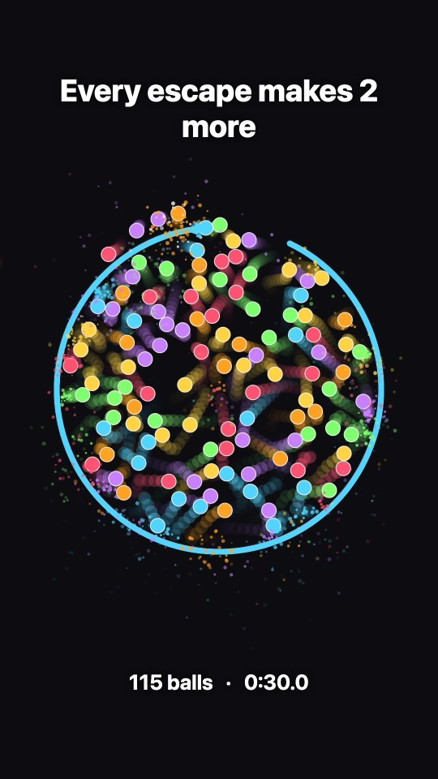
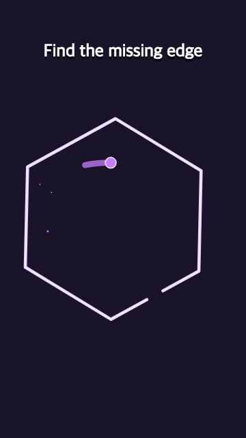
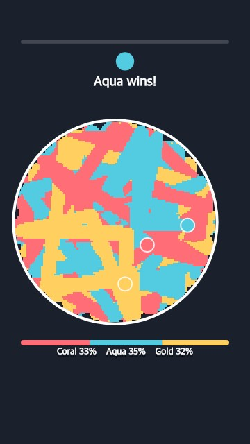
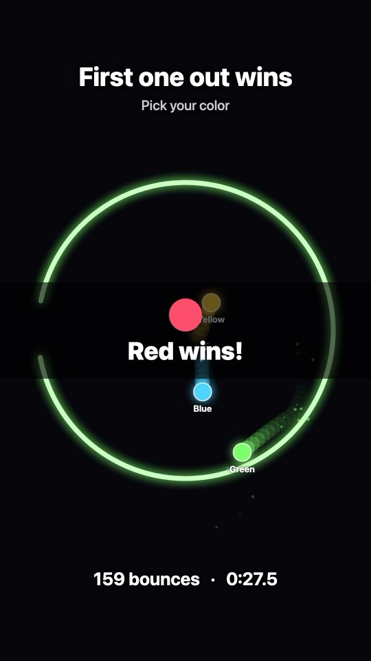

# Ball Escape Studio

**Make satisfying ball-physics shorts in your browser.** Describe a scene in a small JSON file, preview it live with sound, tweak it with sliders, and export a frame-perfect 1080×1920 60 fps MP4 ready for TikTok, Reels, or Shorts.

<p align="center">
  
  
  
  
</p>
<p align="center">
  
  
  
  
</p>

Every run is **deterministic**: the same scene and seed always produce exactly the same video, bounce for bounce. That makes it possible to search hundreds of seeds in seconds for the one with the most dramatic ending, then export exactly that run.

## Features

- **50 formats out of the box**, grouped by family in the gallery. They range from the classics (ring escape, nested rings, multiply, battles, Plinko) to destruction (ring breaker, brick breaker, 45-hit rings), teams (Pong wars territory, rock-paper-scissors, infection, absorb), forces (black holes, vortex drains, portals, orbits) and surreal twists (meowing escapes, gaps that jump, a triangle that becomes a circle, clone trails, merge jars). There are chaos videos too (double pendulums, pendulum waves, butterfly-effect twins, string art) and satisfying ones (picture reveals, rainbow sand, marble races, 100 rings). Each one is just a scene file.
- **V2 building blocks:**
  - **Containers:** breakable rings (segments or hit points).
  - **Solids:** numbered bricks, spinning paddles and blades, bumpers, deadly walls.
  - **Fields:** portals, and forces (attract, repel, vortex, wind; black holes swallow).
  - **Spawning and boards:** emitters, territory boards, kill and finish zones.
  - **Teams:** conversion rules, merge levels, absorb, split, clones.
  - **Weapons:** kinds that power up per hit (sword, dagger, spear, hammer, scythe, bow with arrows, unarmed).
  - **Chaos:** exact double pendulums, ghost copies for butterfly-effect videos.
- **Looks and camera:**
  - **Themes:** neon, pastel, paper, retro, vaporwave, noir, blueprint, candy.
  - **Styles:** balls (glossy, 3D, glass, outline), rings (dashed, neon tube, rainbow, segments), trails (ribbon, comet, rainbow) and color modes (change per bounce, rainbow, heat).
  - **Decoration:** string art, backdrops (stars, grid, gradient, ripples) and post effects (bloom, vignette, grain, scanlines, color fringe, confetti).
  - **Camera:** follow, or zoom out ring by ring, plus screen shake.
  - **Time:** slow motion at the climax and a 3-2-1 countdown. Preview, export and sound share one timing plan, so they stay in sync.
- **More sound:**
  - **Instruments:** seven new ones (glass, chip, piano, kalimba, pop, synth, and a synthesized, in-tune meow).
  - **Event sounds:** breaks, portals, swallows, merges, captures and conversions each have their own.
  - **Climax impact:** a bass drop, cymbal swell or gong.
  - **Pitch modes:** notes can follow ball size, height or speed instead of the melody.
- **Make it weird.** One click stacks two or three surreal modifiers (black hole, portals, gap jumping, splitting, meowing, clones, storm…) onto any scene as an unsaved change.
- **The Director.** Simulates hundreds of runs in a fraction of a second, scores each for the story you want (slow burn, last-second escape, chaos, comeback, in time with the song), and shows the best nine playing side by side. Use one, swipe through them, or export the best.
- **Swipe review and an export queue.** Keep (→) or discard (←) candidates one by one; kept videos render in the background and land in `exports/` with a caption, the exact scene, and a line in `exports/log.csv`.
- **Batch production.** One click makes 4–12 remixes of a scene (new palette, instrument, melody and feel), each auto-directed. **Tournaments** turn any battle into a knockout bracket: every match becomes a scene with a close fight and a winner that advances.
- **The Critic.** Plain-language notes on the current run ("the climax comes at 6s, early for a short", "a 5s stretch where nothing happens", "one ball leads the whole battle"), with a **Fix with Claude** button.
- **Custom rule scripts.** When built-in actions aren't enough, a rule can run a few lines of JavaScript, deterministic and checked in a Worker before it runs.
- **Crowds.** Thousands of balls with WebGL rendering and spatial-hash collisions.
- **A small scene language.** Scenes can `extend` other scenes, stack named `modifiers` (`"multiply"`, `"battle"`, `"gravity-flip"`…), and use prefabs (`nested` rings, a `pegboard`, `bins`). Most new formats need no code at all.
- **Deterministic physics, everywhere.** Fixed 240 Hz timestep, seeded randomness, no wall-clock time, and the engine's own trigonometry (browsers and Node disagree on `Math.sin` in the last bit), so a seed tuned in the terminal plays exactly the same in the studio, in any browser. A state hash proves two runs are identical. `npm run fuzz` stress-tests every scene, seed and modifier combination.
- **Built for the genre.** Spinning rings and polygons with exits, walls, pegs, counting zones, hit points, winners, timed events, and bounces that never lose energy.
- **Live sliders.** Every number in a scene becomes a slider. Changes preview instantly, and **Save to file** writes them back to the JSON.
- **Music from bounces.** Every bounce plays the next note of a song. The built-in **songbook** has 27 public-domain pieces (Bach, Beethoven, Mozart, Grieg, Joplin, folk songs and nursery tunes, as simple melody-and-bass arrangements), plus an improvised pentatonic mode; drag any `.mid` onto the studio to add your own.
- **Rhythm lock.** Every bounce lands exactly on the beat of the song, in any single-ball scene: rings or polygons, with or without gravity. After each bounce the engine flies the ball's next path ahead and sets its speed so it reaches the wall on the next note. **Find a seed that stays in time** in the Music tab picks the cleanest run in one click.
- **Frame-perfect MP4 export.** Frames are rendered one by one, encoded with WebCodecs (H.264 + AAC), and muxed in the browser. A 30 s single-ball video exports in about 10 s, with no dropped frames, even in a background tab.
- **Headless CLI.** `npm run sim` runs a scene in milliseconds, searches seed ranges for the best ending, and prints the event log, for you or for an AI agent.
- **Editor autocomplete.** [`scene.schema.json`](scene.schema.json) gives VS Code completion and inline docs for every field.
- **Ask Claude.** A prompt box runs Claude Code on your regular Claude plan (no API key) to edit or create scenes while you watch, with full version history, undo, and Like/Dislike notes that teach it your taste.

## Quick start

Requires Node 20+ and a recent Chrome or Edge (for MP4 export).

```bash
git clone https://github.com/jaale98/ball-escape-studio.git
cd ball-escape-studio
npm install
npm run dev
```

Open http://localhost:5173. A short welcome card walks through it: pick a format, turn sound on, change it (ask Claude, or use the **Tune** and **Music** tabs), let the Director find the best run, and export.

### The studio at a glance

- **Scene switcher + Browse.** Pick a scene from the list, or **Browse** for a gallery with thumbnails, where you can open, build on (**New from this**), duplicate, rename or delete scenes. Remixes and tournament matches are grouped under the scene they came from. Deleted scenes go to `.studio/trash`.
- **One save model.** Every change (sliders, seed, song, rhythm lock, a Director pick) is an *unsaved change* shown in a bar at the top. **Save** (⌘S) writes it into the scene file; **Discard** drops it. Switching scenes asks first.
- **Tabs.** *Create* (ask Claude, the Critic, Director, export queue, Like/Dislike), *Look* (text, colors, background picture, and names, emoji and photos per ball), *Tune* (seed and every number in the scene), *Music* (song, rhythm lock, parts), *History* (every version of the scene, and every export with Show in Finder / Export again / Open as scene), *Info* (live stats and the raw scene).
- **Timeline.** Under the preview: progress with markers for near-misses, escapes, eliminations and the climax. Click or drag to jump (runs are deterministic, so it jumps to the exact frame); **Climax** (J) jumps to just before it.
- **Export queue.** Exports render in the background, survive a page reload, and land in `exports/` with a caption and the exact scene.

**Keyboard** (press `?` in the studio for the list): `Space` play/pause · `J` jump to climax · `M` sound · `R` new seed · `B` browse · `D` Director · `E` export · `⌘S` save · `Backspace` restart

## Scenes

A scene is a JSON file in `scenes/`. Anything you leave out gets a sensible default, and unknown keys are errors, so typos never fail silently.

```json
{
  "$schema": "../scene.schema.json",
  "title": "Ring escape",
  "seed": 25,
  "duration": { "max": 60, "endOn": "firstEscape", "tail": 2.5 },
  "world": { "gravity": 900 },
  "entities": [
    { "type": "ring", "radius": 420, "thickness": 14, "spin": 0.9, "gaps": [{ "at": 0, "width": 26 }] },
    { "type": "ball", "radius": 24, "speed": 900 }
  ],
  "style": { "trail": 0.85 },
  "audio": { "melody": "pentatonic", "instrument": "pluck" },
  "overlay": { "title": "Can it escape?", "counter": "bounces" }
}
```

### Building on other scenes

Most formats are a base scene plus a twist. This is the whole `multiply` preset:

```json
{
  "extends": "ring-escape",
  "title": "Multiply on escape",
  "modifiers": ["multiply"],
  "duration": { "max": 40 },
  "overlay": { "title": "Every escape makes 2 more" }
}
```

`extends` merges objects key by key and replaces arrays. Modifiers stack and take options: `"modifiers": ["zero-g", { "use": "shrinking-gap", "amount": 2 }]`.

| Modifier | What it does |
| --- | --- |
| `grow-on-bounce` | The ball grows each bounce (`amount`); ends when it fills the ring |
| `shrinking-gap` | The exit narrows each bounce (`amount`, `min`) |
| `speed-up` / `spin-up` | Each bounce speeds up the ball / the container (`factor`, `max`) |
| `multiply` | Each escape spawns more balls inside (`count`); runs to the time limit |
| `battle` | Balls get hit points (`hp`) and lose `damage` per collision; the last one standing wins |
| `race` | The first ball out wins (shown with a winner banner) |
| `gravity-flip` / `gravity-spin` | Gravity reverses / rotates on a timer (`every`, `degrees`) |
| `zero-g` | No gravity |
| `paint` | Balls leave permanent paint instead of fading trails |
| `break-rings` / `hp-ring` | Rings break segment by segment (`segments`, `hp`) / shatter after `hp` bounces |
| `split` / `absorb` / `merge` | Every bounce splits the ball / bigger eats smaller / same levels merge |
| `infection` / `rps` | Team conversion: one zombie (`chance`) / rock-paper-scissors |
| `black-hole` / `storm` / `portals` | A black hole that grows (`strength`, `swallow`, `grow`) / a shrinking arena / a portal pair |
| `add-side` / `gap-jump` / `clone-trail` | Polygon gains a side / the gap jumps / each bounce leaves a clone |
| `butterfly` | Ghost copies a millionth of a degree apart (`copies`) |
| `string-art` / `rainbow` / `meow` | Lines between bounces / rainbow colors and trails / every bounce meows |
| `slowmo` / `shake` / `countdown` | Slow motion at the climax / screen shake / a 3-2-1 intro |

### Building blocks

| Section | What it controls |
| --- | --- |
| `entities` | `ring` (radius, spin, gaps, `hp`, `segments`, `deadly`), `polygon` (sides, open sides, exit `gap`, `hp`), `wall` / `peg` (`boost` bumpers, `deadly`, `hp`), `brick`, `spinner`, `portal`, `force` (attract, repel, vortex, wind), `emitter`, `territory`, `pendulum`, `zone` (counts; `kill` drains, `finish` lines), `ball` (radius, speed, count, colors, labels, hp, `weapon` with `kind`, `shape`, `frozen`, `arrange`, `team`, `level`, `copies`), and prefabs: `nested`, `pegboard`, `bins`, `brickwall`, `funnel`, `course` |
| `teams` | Team names, colors, emoji and who beats whom |
| `rules` | On `bounce`, `escape`, `hit`, `eliminate`, `strike`, `wake`, `break`, `teleport`, `swallow`, `capture`, `merge`, `convert`, `corner` or `finish`: `grow`, `shrinkGap`, `speedUp`, `spawn`, `damage`, `spinUp`, `reverseSpin`, gravity changes, `split`, `absorb`, `merge`, `convert`, `clone`, `moveGap`, `addGap`, `addSide`, `shrinkContainer`, `recolor`, `growForce`, `end`, or a `script` |
| `timeline` | Do the same actions `at` a time or `every` N seconds (spawners, gravity flips…) |
| `duration` | Length cap and what ends the run: `firstEscape`, `allEscaped`, `lastStanding`, `oneTeam`, `finish`, `cleared`, `never`; `trimStart` for loops |
| `camera` | `mode` (fixed, follow, zoomOut), zoom, `shake`, `slowmo` (+ factor, lead), `countdown` |
| `world` | Gravity (number or `[x, y]`), energy keeping, restitution, friction, ball cap |
| `style` | Background color or picture, palette, ring color, `theme`, ball / ring / trail style, `colorMode`, string-art `lines`, `backdrop`, bloom, vignette, grain, scanlines, chromatic, confetti, trail length, glow, paint, hp rings, picture `reveal` |
| `audio` | Melody (`pentatonic`, `ode-to-joy`, `fur-elise`, `midi:<file>`) or inline `notes`, chords, transpose, instrument (10), `pitchBy`, `climax` sound, event sounds |
| `overlay` | Title, subtitle, font, text color, sizes and positions, counter (bounces, balls, escaped, teams, rings, bricks, hp), timer, winner banner, zone counts, `endCard`, per-bounce `reveal` text, `progress` bar |

The full schema with every default lives in [`src/engine/scene.ts`](src/engine/scene.ts) and [`scene.schema.json`](scene.schema.json).

### The presets

| Scene | Format | Built from |
| --- | --- | --- |
| [`ring-escape`](scenes/ring-escape.json) | One ball, one spinning ring, one gap | base scene |
| [`grow-on-bounce`](scenes/grow-on-bounce.json) | Escape before you fill the ring | ring-escape + `grow-on-bounce` |
| [`shrinking-gap`](scenes/shrinking-gap.json) | The exit narrows with every bounce | ring-escape + `zero-g` + `shrinking-gap` |
| [`multiply`](scenes/multiply.json) | Every escape spawns two more | ring-escape + `multiply` |
| [`gravity-flip`](scenes/gravity-flip.json) | Gravity reverses every 4 s | ring-escape + `gravity-flip` |
| [`music-bounce`](scenes/music-bounce.json) | A ring escape where every bounce is a note of the song, in time | ring-escape + `midi:minuet-in-g` + `rhythmLock` (with gravity) |
| [`rhythm-bounce`](scenes/rhythm-bounce.json) | Every bounce lands in time with the song | music-bounce + `zero-g` + `rhythmLock` |
| [`ball-race`](scenes/ball-race.json) | Four named balls, first one out wins | ring-escape + `race` |
| [`nested-rings`](scenes/nested-rings.json) | Five counter-rotating rings | `nested` prefab |
| [`battle-royale`](scenes/battle-royale.json) | Hit points, last ball standing | closed ring + `battle` |
| [`country-battle`](scenes/country-battle.json) | Same battle with country names and colors | battle-royale + labels |
| [`hexagon-escape`](scenes/hexagon-escape.json) | A spinning hexagon with a narrow exit | `polygon` |
| [`plinko`](scenes/plinko.json) | Balls rain through pegs into counted bins | `pegboard` + `bins` + timeline spawner |
| [`paint-the-ring`](scenes/paint-the-ring.json) | Which color covers more? | closed ring + `paint` + `zero-g` |
| [`weapon-battle`](scenes/weapon-battle.json) | Four balls with spinning blades; strikes cost hp, clashing blades bounce | ball `weapon` |
| [`bouncing-square`](scenes/bouncing-square.json) | A spinning square tries to escape | ring-escape + ball `shape` |
| [`chain-reaction`](scenes/chain-reaction.json) | One moving ball passes its motion along a grid of frozen balls | `frozen` balls + `arrange: grid` + a `wake` rule script |
| [`eternal-loop`](scenes/eternal-loop.json) | A seamless loop found by the Director | `trimStart` loop window |
| [`crowd-pour`](scenes/crowd-pour.json) | 2,000 balls drain through a gap two balls wide | timeline spawner, WebGL crowd |

**New in V2** (31 more):

| Scene | Format | Built from |
| --- | --- | --- |
| [`ring-breaker`](scenes/ring-breaker.json) | Smash through 12 layers of breakable segments | `nested` + `segments` |
| [`hp-ring`](scenes/hp-ring.json) | 45 hits to break out | ring `hp` + `climax: gong` |
| [`crusher`](scenes/crusher.json) | A spinning paddle makes more balls until the ring bursts | `spinner` + script spawn + ring `hp` |
| [`brick-breaker`](scenes/brick-breaker.json) | Clear the wall of numbered bricks | `brickwall` + `endOn: cleared` |
| [`pong-wars`](scenes/pong-wars.json) | Day vs night territory | `territory` + teams |
| [`color-war`](scenes/color-war.json) | Four colors fight for the board | `territory` quadrants |
| [`rock-paper-scissors`](scenes/rock-paper-scissors.json) | Who takes over? | `rps` |
| [`infection`](scenes/infection.json) | 1 zombie vs 30 humans | `infection` |
| [`absorb`](scenes/absorb.json) | Bigger eats smaller | `absorb` |
| [`weapon-legends`](scenes/weapon-legends.json) | Sword vs dagger vs spear vs bow vs fists vs hammer | weapon `kind`s that power up |
| [`shrinking-arena`](scenes/shrinking-arena.json) | Battle royale with a storm | `battle` + `storm` |
| [`survival`](scenes/survival.json) | Dodge the spinning blade | deadly `spinner` + `storm` |
| [`black-hole`](scenes/black-hole.json) | Don't get eaten | `black-hole` |
| [`orbit-escape`](scenes/orbit-escape.json) | Slingshot out of a sun's pull | `force: attract` |
| [`vortex-drain`](scenes/vortex-drain.json) | Marbles spiral down a drain, forever | `force: vortex` + `kill` zone + looping `emitter` |
| [`portal-escape`](scenes/portal-escape.json) | The only way out is a portal | `portal` |
| [`meow-escape`](scenes/meow-escape.json) | The cat meows the song | `meow` + emoji |
| [`gap-jumper`](scenes/gap-jumper.json) | The exit keeps moving | `gap-jump` |
| [`every-bounce-a-side`](scenes/every-bounce-a-side.json) | Triangle to circle | `add-side` |
| [`clone-trail`](scenes/clone-trail.json) | Every bounce leaves a clone | `clone-trail` |
| [`split-swarm`](scenes/split-swarm.json) | Every bounce splits it | `split` + `rainbow` |
| [`merge-jar`](scenes/merge-jar.json) | Two of a kind merge | `emitter` levels + `merge` |
| [`corner-hit`](scenes/corner-hit.json) | Will it hit the corner? | `corner` rule + `end` |
| [`chaos-pendulums`](scenes/chaos-pendulums.json) | 8 double pendulums 0.001° apart | `pendulum` |
| [`pendulum-wave`](scenes/pendulum-wave.json) | 15 pendulums make waves | `pendulum` with `wave` |
| [`butterfly-effect`](scenes/butterfly-effect.json) | 12 balls a hair apart drift into chaos | `butterfly` |
| [`string-art`](scenes/string-art.json) | Every bounce draws a line | `string-art` |
| [`picture-reveal`](scenes/picture-reveal.json) | 1,600 balls settle and spell a word | `emitter` + `style.reveal` |
| [`sand-pour`](scenes/sand-pour.json) | Rainbow sand through pegs | `funnel` + `pegboard` + `emitter` |
| [`marble-race`](scenes/marble-race.json) | Eight marbles race a course to the line | `course` + `finish` zone + slow motion |
| [`hundred-rings`](scenes/hundred-rings.json) | Can it escape 100 rings? | `nested` × 100 + `camera.mode: zoomOut` |

## The Director

Click **Director** in the studio. Pick a story, set when the climax should land, and click **Find the best runs**. The Director simulates every candidate in Web Workers (300 runs of a 30 s scene take well under a second), optionally nudging ball speed and container spin by up to ±10%, then refines around the best five.

| Story | What it rewards |
| --- | --- |
| Slow burn | Climax near the target, near-misses building toward it, no dead stretches |
| Last-second escape | Climax almost exactly on the target, lots of near-misses |
| Chaos | As many hits and balls as possible |
| Comeback | Races and battles where the lead changes and the winner was behind at halftime |
| In time with the song | Bounces that follow the MIDI song's note timing |
| Perfect loop | A stretch whose last frame matches its first (sets the loop window for export) |
| Underdog | Team formats where the side behind at halfway takes over |
| Photo finish | Races won by a hair |
| Destruction | Lots of breaks, with the last one near the target |

The best nine play side by side. **Use** makes one the scene's seed (plus `world.speedScale` / `world.spinScale` tweaks; **Save to file** keeps them). **Export** queues it, and **Review one by one** opens the swipe view.

### Batch production

In the Director's **Batch** row:

- **Make remixes** builds 4–12 versions of the scene (new palette, background, instrument, melody, and a little speed and spin) and directs each one. **Save** keeps a remix as its own scene file; **Export** queues it.
- **Build tournament** (battle scenes) runs a knockout bracket for the names you list. Each match is a one-on-one battle that extends your scene, with a seed picked for a close fight near your target length. Winners advance, and **Save all as scenes** writes the bracket to `scenes/`. From the terminal:

```bash
npm run tournament -- country-battle "Brazil,Japan,France,Canada,Italy,Mexico,Kenya,Sweden" --name world-cup
```

Every queued export saves `exports/<name>.mp4`, `<name>.txt` (hook, caption, hashtags), `<name>.scene.json` (the exact scene, to remake or extend it later), and a row in `exports/log.csv`.

### Custom rule scripts

A rule (or timeline entry) can run JavaScript instead of, or as well as, built-in actions:

```json
{ "on": "wake", "script": "ctx.other.frozen = true; ctx.ball.color = ctx.other.color;" }
```

Scripts get `ctx.ball`, `ctx.other`, `ctx.container`, `ctx.world` (`balls()`, `spawn()`, `do(action)`, `gravity(x, y)`, `end()`), seeded `ctx.rng`, and a persistent `ctx.state`. `Math.random`, `Date`, timers and network access aren't available, so runs stay deterministic. The full reference is in [`src/engine/script.ts`](src/engine/script.ts). The studio runs scripted scenes headless in a Worker first, so a script that loops forever fails there instead of freezing the page.

Scripts are code: like any code, only run scene files you trust.

### Text, photos and emoji

The **Look** tab covers everything visible that isn't physics:

- **Text:** title and subtitle (empty = none), font (clean, rounded, serif, mono, bold condensed), text color, and the size and position of the title, counter and ball names. Switches for the timer, the winner banner, hit points and bin counts, and a counter picker (bounces, balls left, escaped, none).
- **Colors and background:** background and ring colors, and a **background picture** (cropped to fill, with a darken slider so balls stay readable).
- **Balls:** for each ball, a name, an **emoji** (🍕, 🔥… flags like 🇧🇷 render on Mac; the country battle uses them) and a **photo**. Photos are cropped into the ball's shape and turn with it; the winner banner shows the winner's photo or emoji.

Drop pictures (PNG, JPG, WebP, GIF, SVG) anywhere on the studio to add them to `images/`. In a scene file:

```json
{ "type": "ball", "count": 2, "labels": ["Cat", "Dog"], "images": ["cat.jpg", "dog.jpg"] },
{ "type": "ball", "emoji": "🍕" }
```
```json
"style": { "backgroundImage": "sky.jpg", "backgroundDim": 0.4 },
"overlay": { "title": "Cat vs Dog", "font": "condensed", "titleSize": 96, "titleY": 220, "timer": false }
```

### Picture reveal, slow motion and the camera

- **Picture reveal:** set `style.reveal` to a `text` or an `image` from `images/`. The studio runs the scene once, sees where every ball lands, and colors each ball by the word or picture at its landing spot. Colors don't touch the physics, so the real run lands the same way and the picture appears. The Look tab has a Picture reveal section for it.
- **Slow motion:** `camera.slowmo` (video seconds, around the climax, starting `slowmoLead` before it) and the `countdown` intro change how many physics steps go into each frame, never the physics. One timing plan (`src/engine/timing.ts`) drives the preview, the export and the soundtrack, so a slow-motion export keeps picture and sound in sync.
- **Camera:** `camera.mode: "zoomOut"` frames the innermost ring the ball is still inside, so a hundred rings fit a vertical video. `follow` keeps the action centered, and `shake` kicks on breaks, escapes and knockouts.

### Rhythm lock

Turn it on in the **Music** tab, or set `"audio": { "melody": "midi:<song>", "rhythmLock": true }`. It works for any scene with one ball bouncing in a ring or polygon, with or without gravity (it can't work with several balls: their bounces can't all land on the beat, and the tab says so). After every bounce the engine flies the ball's next path ahead and sets its launch speed so it hits the wall exactly when the next note is due. Under gravity there can be several speeds that work; it picks the one closest to the current speed, so the motion stays smooth.

Some paths can't hit a particular beat (a ball skimming along the wall, say), so not every seed stays in time. **Find a seed that stays in time** (or the Director's *In time with the song* story) tries 150 seeds and keeps the best; with it, ring escapes, gravity flips, polygons and the bouncing square typically land 85–100% of notes on time. The tempo is chosen automatically between half and double the song's own; the Tempo slider overrides it.

### Multitrack songs

A MIDI file usually has several tracks (melody, piano, bass…). The **Music** tab lists them with their real names, instrument, range and note count, each with a ▶ preview:

- **Bounces play**: the melody track, auto-detected (the busiest high, single-line part, so a chordal piano part doesn't win just by sitting higher), or any one track, or everything merged. **Play chords** plays every note struck together instead of just the top one.
- **Backing** (with rhythm lock): the other tracks play in time underneath, each switchable, with its own volume. Without rhythm lock the bounces have no timing to follow, so backing is off.
- Drum tracks are skipped (they have no notes to play on a bounce), and the tab says so.

In a scene file: `"parts": [2]` picks the bounce track (default: the detected melody), `"backing": true` turns backing on, `"backingParts": [0, 3]` limits it, `"backingVolume": 0.5`.

The songbook lives in [`scripts/songbook.ts`](scripts/songbook.ts) in a compact note notation; `npm run songs` regenerates `songs/*.mid` and `songs/songs.json`.

## Finding the perfect seed

The engine runs a 30-second scene headless in a few milliseconds, so you can search seeds before you watch anything:

```bash
npm run sim -- ring-escape --seeds 1-500 --target 30
```

This lists the seeds whose climax (first escape, last elimination, or fill) lands closest to 0:30, along with each winner. Put the one you like in the scene's `seed` field (or type it into the studio).

```bash
npm run sim -- ring-escape              # summary of one run
npm run sim -- ring-escape --events     # every bounce, escape and hit, timestamped
npm run sim -- ring-escape --resolved   # the scene after extends, modifiers and prefabs
npm run sim -- ring-escape --director slow-burn --target 30 --vary 0.1   # the Director, headless
npm test                                # every scene resolves and replays identically
npm run fuzz                            # stress test: every scene × seeds, every modifier, random combos
npm run schema                          # regenerate scene.schema.json
```

## Ask Claude

The studio has a prompt box. Type what you want, such as *"make the gap shrink faster and use bell sounds"* or *"a new video: three balls race out of a hexagon, named after planets"*, and Claude edits or creates the scene while you watch. The preview updates the moment the file is written, without a page reload.

- **Runs on your Claude plan, not API credits.** The dev server runs the [Claude Code](https://claude.com/claude-code) CLI (`claude -p`) in this folder, with `ANTHROPIC_API_KEY` removed from its environment. You need Claude Code installed and logged in (`claude`, then `/login`).
- **Scoped.** In the prompt box Claude can only read the project, edit files in `scenes/`, and run `npm run sim` / `npm test`. Everything else is denied automatically.
- **Fast or Smart.** Fast (Haiku) for quick edits, Smart (Sonnet) for new formats. Follow-up prompts on the same scene continue the same conversation; **New chat** starts fresh.
- **History and undo.** Every version of every scene (from Claude, slider saves, or your editor) is kept in `.studio/history`. **Undo last change** or restore any version; restoring adds a new version, so nothing is ever lost.
- **It learns your taste.** **Like** / **Dislike** (with an optional note) append to `.studio/taste.md`, which Claude reads before making scenes.

You can also skip the prompt box and talk to Claude Code directly in this folder ("folder mode"). It follows the same conventions from [`CLAUDE.md`](CLAUDE.md): start from the closest preset, validate with `npm run sim`, tune the seed, and look at exact frames with `studio.capture()`.

`npm run eval:ai` runs ten typical requests through the prompt-box path and reports how many produce valid scenes and how quickly the first scene write lands. Last run (Fast model, Claude Code 2.1.87): **10/10 valid on the first try, median 7.6 s to the first preview update**, 9–30 s per request in total. A follow-up edit to an existing scene ("make the ring red") updated the preview in about 3 s.

## How it works

```
scenes/*.json ─► resolveScene: extends ─► modifiers ─► prefabs ─► zod validation
                                                                     │
                                         World (240 Hz physics) ◄────┘
                                                │
                                            event log
          ┌──────────────────┬──────────────────┼───────────────────┐
          ▼                  ▼                  ▼                   ▼
      Renderer          SoundMapper        Stats / UI          sim CLI
    (Canvas 2D)    (melody, MIDI, synth)
          │                  │
          └──── MP4 export: re-simulate, draw every frame,
                WebCodecs H.264 + offline-rendered AAC, mp4-muxer
```

- **`src/engine/`** holds the simulation: scene schema, the scene language (`source.ts`, `modifiers.ts`), seeded RNG, and the physics world. It has no DOM dependencies and runs in Node.
- **`src/render/`** draws a world onto a 1080×1920 canvas. Effects are driven only by the event log and a seeded RNG, so the export matches the preview.
- **`src/audio/`** maps events to notes, reads MIDI files, and synthesizes sound with Web Audio. The same code drives live playback and the offline mixdown.
- **`src/export/`** handles the frame-by-frame MP4 encoder and deterministic still frames.
- **`src/director/`** holds the Director: run scoring and story templates (`score.ts`, also used by the CLI), the Web Worker pool, the Critic, remixes, tournaments, captions, and the script preflight.
- **`src/ui/`** holds the sliders, prompt box, history, music panel, Director view, swipe review, and export queue.
- **`server/`** holds the dev-server endpoints, including the Claude Code runner (`claude.ts`) and scene history.

Export runs the scene twice: a headless pass that learns the length and every event (for the soundtrack), then a rendering pass. Both must end on the same state hash, which the studio reports after each export.

## Roadmap

1. **Core engine and export** (done)
2. **Scene language:** inheritance, modifiers, prefabs, sliders, MIDI, 13 formats (done)
3. **AI through Claude Code:** prompt box on your own plan, version history and undo, taste notes (done)
4. **The Director:** story-scored seed search in Web Workers, variant grid, swipe review, export queue, MIDI upload / part picker, rhythm lock (done)
5. **Full studio:** all 16 catalog formats, custom rule scripts, WebGL crowds, perfect loops, the Critic, remixes, tournaments, captions and run logs (done)

## License

[MIT](LICENSE). The bundled melodies (*Ode to Joy*, *Für Elise*, *Minuet in G*) are in the public domain.
