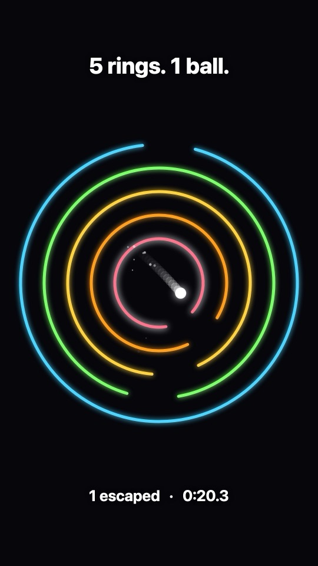
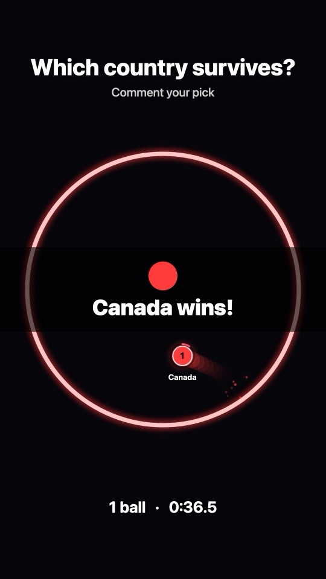
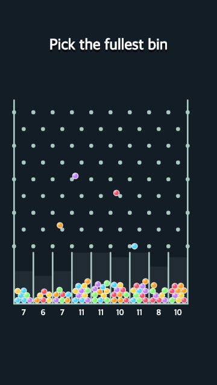

# Ball Escape Studio

**Make satisfying ball-physics shorts in your browser.** Describe a scene in a small JSON file, preview it live with sound, tweak it with sliders, and export a frame-perfect 1080×1920 60 fps MP4 ready for TikTok, Reels, or Shorts.

<p align="center">
  
  
  
  
</p>
<p align="center">
  
  
  
  
</p>

Every run is **deterministic**: the same scene and seed always produce exactly the same video, bounce for bounce. That makes it possible to search hundreds of seeds in seconds for the one with the most dramatic ending, then export exactly that run.

## Features

- **13 formats out of the box:** ring escape, nested rings, multiply, grow on bounce, shrinking gap, ball race, battle royale, country battle, Plinko, hexagon escape, paint the ring, gravity flip, and music bounce. Each one is just a scene file.
- **A small scene language.** Scenes can `extend` other scenes, stack named `modifiers` (`"multiply"`, `"battle"`, `"gravity-flip"`…), and use prefabs (`nested` rings, a `pegboard`, `bins`). Most new formats need no code at all.
- **Deterministic physics.** Fixed 240 Hz timestep, seeded randomness, no wall-clock time. A state hash proves two runs are identical.
- **Built for the genre.** Spinning rings and polygons with exits, walls, pegs, counting zones, hit points, winners, timed events, and bounces that never lose energy.
- **Live sliders.** Every number in a scene becomes a slider. Changes preview instantly, and **Save to file** writes them back to the JSON.
- **Music from bounces.** Every bounce plays the next note of a melody: improvised pentatonic, *Ode to Joy*, *Für Elise*, or **any MIDI file** you drop into `songs/` (with optional chords). There are synth instruments plus hit, pop and escape sounds.
- **Frame-perfect MP4 export.** Frames are rendered one by one, encoded with WebCodecs (H.264 + AAC), and muxed in the browser. A 30 s single-ball video exports in about 10 s, with no dropped frames, even in a background tab.
- **Headless CLI.** `npm run sim` runs a scene in milliseconds, searches seed ranges for the best ending, and prints the event log, for you or for an AI agent.
- **Editor autocomplete.** [`scene.schema.json`](scene.schema.json) gives VS Code completion and inline docs for every field.
- **Ask Claude.** A prompt box runs Claude Code on your regular Claude plan (no API key) to edit or create scenes while you watch, with full version history, undo, and Like/Dislike notes that teach it your taste.

## Quick start

Requires Node 20+ and a recent Chrome or Edge (for MP4 export).

```bash
git clone https://github.com/jaale98/ball-escape-studio.git
cd ball-escape-studio
npm install
npm run dev
```

Open http://localhost:5173, pick a scene, press **Sound off** to turn sound on, drag some sliders or ask Claude for a change, and click **Export MP4**.

**Keyboard:** `Space` play/pause · `R` reroll seed · `M` sound · `Backspace` restart

## Scenes

A scene is a JSON file in `scenes/`. Anything you leave out gets a sensible default, and unknown keys are errors, so typos never fail silently.

```json
{
  "$schema": "../scene.schema.json",
  "title": "Ring escape",
  "seed": 25,
  "duration": { "max": 60, "endOn": "firstEscape", "tail": 2.5 },
  "world": { "gravity": 900 },
  "entities": [
    { "type": "ring", "radius": 420, "thickness": 14, "spin": 0.9, "gaps": [{ "at": 0, "width": 26 }] },
    { "type": "ball", "radius": 24, "speed": 900 }
  ],
  "style": { "trail": 0.85 },
  "audio": { "melody": "pentatonic", "instrument": "pluck" },
  "overlay": { "title": "Can it escape?", "counter": "bounces" }
}
```

### Building on other scenes

Most formats are a base scene plus a twist. This is the whole `multiply` preset:

```json
{
  "extends": "ring-escape",
  "title": "Multiply on escape",
  "modifiers": ["multiply"],
  "duration": { "max": 40 },
  "overlay": { "title": "Every escape makes 2 more" }
}
```

`extends` merges objects key by key and replaces arrays. Modifiers stack and take options: `"modifiers": ["zero-g", { "use": "shrinking-gap", "amount": 2 }]`.

| Modifier | What it does |
| --- | --- |
| `grow-on-bounce` | The ball grows each bounce (`amount`); ends when it fills the ring |
| `shrinking-gap` | The exit narrows each bounce (`amount`, `min`) |
| `speed-up` / `spin-up` | Each bounce speeds up the ball / the container (`factor`, `max`) |
| `multiply` | Each escape spawns more balls inside (`count`); runs to the time limit |
| `battle` | Balls get hit points (`hp`) and lose `damage` per collision; the last one standing wins |
| `race` | The first ball out wins (shown with a winner banner) |
| `gravity-flip` / `gravity-spin` | Gravity reverses / rotates on a timer (`every`, `degrees`) |
| `zero-g` | No gravity |
| `paint` | Balls leave permanent paint instead of fading trails |

### Building blocks

| Section | What it controls |
| --- | --- |
| `entities` | `ring` (radius, spin, gaps), `polygon` (sides, open sides, exit `gap`), `wall`, `peg`, `zone` (counts balls entering), `ball` (radius, speed, count, colors, labels, hp), and prefabs: `nested`, `pegboard`, `bins` |
| `rules` | On `bounce`, `escape`, `hit` or `eliminate`: `grow`, `shrinkGap`, `speedUp`, `spawn`, `damage`, `spinUp`, `reverseSpin`, gravity changes |
| `timeline` | Do the same actions `at` a time or `every` N seconds (spawners, gravity flips…) |
| `duration` | Length cap and what ends the run: `firstEscape`, `allEscaped`, `lastStanding`, `never` |
| `world` | Gravity (number or `[x, y]`), energy keeping, restitution, friction, ball cap |
| `style` | Background, palette, ring color, trail length, glow, paint, hp rings |
| `audio` | Melody (`pentatonic`, `ode-to-joy`, `fur-elise`, `midi:<file>`) or inline `notes`, chords, transpose, instrument, sound effects |
| `overlay` | Title, subtitle, counter, timer, winner banner, zone counts |

The full schema with every default lives in [`src/engine/scene.ts`](src/engine/scene.ts) and [`scene.schema.json`](scene.schema.json).

### The presets

| Scene | Format | Built from |
| --- | --- | --- |
| [`ring-escape`](scenes/ring-escape.json) | One ball, one spinning ring, one gap | base scene |
| [`grow-on-bounce`](scenes/grow-on-bounce.json) | Escape before you fill the ring | ring-escape + `grow-on-bounce` |
| [`shrinking-gap`](scenes/shrinking-gap.json) | The exit narrows with every bounce | ring-escape + `zero-g` + `shrinking-gap` |
| [`multiply`](scenes/multiply.json) | Every escape spawns two more | ring-escape + `multiply` |
| [`gravity-flip`](scenes/gravity-flip.json) | Gravity reverses every 4 s | ring-escape + `gravity-flip` |
| [`music-bounce`](scenes/music-bounce.json) | Each bounce plays the next note of a MIDI song | ring-escape + `speed-up` + `midi:minuet-in-g` |
| [`ball-race`](scenes/ball-race.json) | Four named balls, first one out wins | ring-escape + `race` |
| [`nested-rings`](scenes/nested-rings.json) | Five counter-rotating rings | `nested` prefab |
| [`battle-royale`](scenes/battle-royale.json) | Hit points, last ball standing | closed ring + `battle` |
| [`country-battle`](scenes/country-battle.json) | Same battle with country names and colors | battle-royale + labels |
| [`hexagon-escape`](scenes/hexagon-escape.json) | A spinning hexagon with a narrow exit | `polygon` |
| [`plinko`](scenes/plinko.json) | Balls rain through pegs into counted bins | `pegboard` + `bins` + timeline spawner |
| [`paint-the-ring`](scenes/paint-the-ring.json) | Which color covers more? | closed ring + `paint` + `zero-g` |

## Finding the perfect seed

The engine runs a 30-second scene headless in a few milliseconds, so you can search seeds before you watch anything:

```bash
npm run sim -- ring-escape --seeds 1-500 --target 30
```

This lists the seeds whose climax (first escape, last elimination, or fill) lands closest to 0:30, along with each winner. Put the one you like in the scene's `seed` field (or type it into the studio).

```bash
npm run sim -- ring-escape              # summary of one run
npm run sim -- ring-escape --events     # every bounce, escape and hit, timestamped
npm run sim -- ring-escape --resolved   # the scene after extends, modifiers and prefabs
npm test                                # every scene resolves and replays identically
npm run schema                          # regenerate scene.schema.json
```

## Ask Claude

The studio has a prompt box. Type what you want, such as *"make the gap shrink faster and use bell sounds"* or *"a new video: three balls race out of a hexagon, named after planets"*, and Claude edits or creates the scene while you watch. The preview updates the moment the file is written, without a page reload.

- **Runs on your Claude plan, not API credits.** The dev server runs the [Claude Code](https://claude.com/claude-code) CLI (`claude -p`) in this folder, with `ANTHROPIC_API_KEY` removed from its environment. You need Claude Code installed and logged in (`claude`, then `/login`).
- **Scoped.** In the prompt box Claude can only read the project, edit files in `scenes/`, and run `npm run sim` / `npm test`. Everything else is denied automatically.
- **Fast or Smart.** Fast (Haiku) for quick edits, Smart (Sonnet) for new formats. Follow-up prompts on the same scene continue the same conversation; **New chat** starts fresh.
- **History and undo.** Every version of every scene (from Claude, slider saves, or your editor) is kept in `.studio/history`. **Undo last change** or restore any version; restoring adds a new version, so nothing is ever lost.
- **It learns your taste.** **Like** / **Dislike** (with an optional note) append to `.studio/taste.md`, which Claude reads before making scenes.

You can also skip the prompt box and talk to Claude Code directly in this folder ("folder mode"). It follows the same conventions from [`CLAUDE.md`](CLAUDE.md): start from the closest preset, validate with `npm run sim`, tune the seed, and look at exact frames with `studio.capture()`.

`npm run eval:ai` runs ten typical requests through the prompt-box path and reports how many produce valid scenes and how quickly the first scene write lands. Last run (Fast model, Claude Code 2.1.87): **10/10 valid on the first try, median 7.6 s to the first preview update**, 9–30 s per request in total. A follow-up edit to an existing scene ("make the ring red") updated the preview in about 3 s.

## How it works

```
scenes/*.json ─► resolveScene: extends ─► modifiers ─► prefabs ─► zod validation
                                                                     │
                                         World (240 Hz physics) ◄────┘
                                                │
                                            event log
          ┌──────────────────┬──────────────────┼───────────────────┐
          ▼                  ▼                  ▼                   ▼
      Renderer          SoundMapper        Stats / UI          sim CLI
    (Canvas 2D)    (melody, MIDI, synth)
          │                  │
          └──── MP4 export: re-simulate, draw every frame,
                WebCodecs H.264 + offline-rendered AAC, mp4-muxer
```

- **`src/engine/`** holds the simulation: scene schema, the scene language (`source.ts`, `modifiers.ts`), seeded RNG, and the physics world. It has no DOM dependencies and runs in Node.
- **`src/render/`** draws a world onto a 1080×1920 canvas. Effects are driven only by the event log and a seeded RNG, so the export matches the preview.
- **`src/audio/`** maps events to notes, reads MIDI files, and synthesizes sound with Web Audio. The same code drives live playback and the offline mixdown.
- **`src/export/`** handles the frame-by-frame MP4 encoder and deterministic still frames.
- **`src/ui/`** holds the sliders, the prompt box, and the history panel.
- **`server/`** holds the dev-server endpoints, including the Claude Code runner (`claude.ts`) and scene history.

Export runs the scene twice: a headless pass that learns the length and every event (for the soundtrack), then a rendering pass. Both must end on the same state hash, which the studio reports after each export.

## Roadmap

1. **Core engine and export** (done)
2. **Scene language:** inheritance, modifiers, prefabs, sliders, MIDI, 13 formats (done)
3. **AI through Claude Code:** prompt box on your own plan, version history and undo, taste notes (done)
4. **The Director:** automatic seed search scored for suspense, a variant grid, swipe-to-keep review
5. **Full studio:** WebGL crowds, custom rule scripts, batch production and series tools

## License

[MIT](LICENSE). The bundled melodies (*Ode to Joy*, *Für Elise*, *Minuet in G*) are in the public domain.
